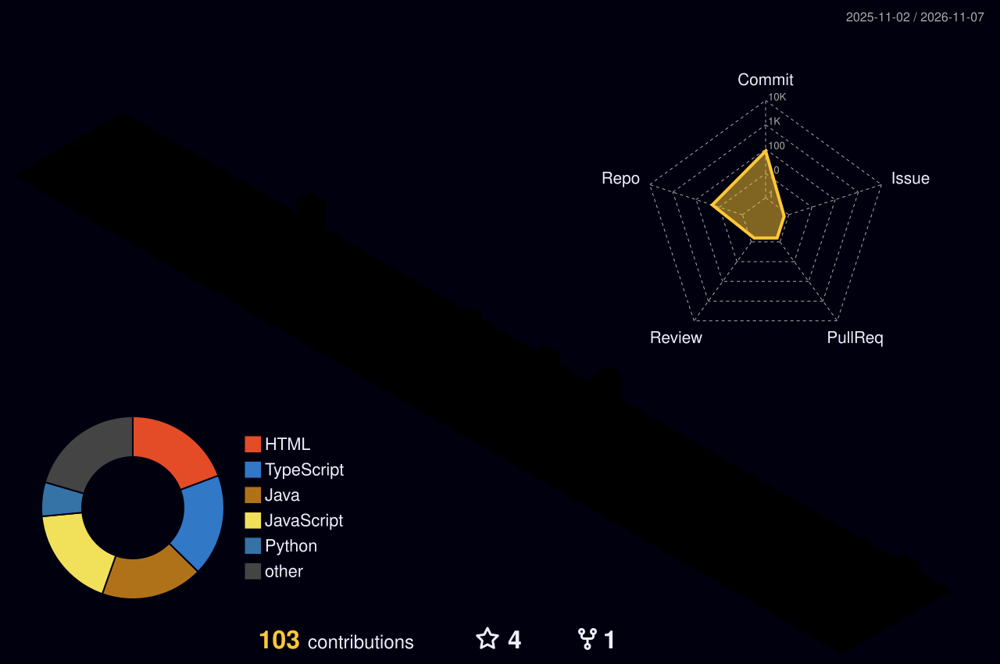

 <!-- GitHub Profile README: dinesh6017l -->

<div align="center">


<br/>


</div>

---

## `01` — About Me

```yaml
name: Dinesh Bhandari
username: dinesh6017l
education: B.E. Geomatics Engineering
university: Kathmandu University
interests:
  - GeoAI & Deep Learning
  - Remote Sensing
  - UAV Photogrammetry
  - GIS & Spatial Analysis
  - Digital Earth
currently_exploring: Geospatial AI and intelligent mapping
```

I am a Geomatics Engineering student interested in combining geospatial science, remote sensing, and artificial intelligence to solve real-world mapping challenges.

My work focuses on extracting meaningful information from satellite and UAV imagery, developing geospatial workflows, and exploring deep learning for automated feature extraction.

---

## `02` — Technology Stack

<div align="center">

### Programming & Development


### AI & Computer Vision


### Geospatial Ecosystem


### Python Geospatial Libraries


</div>

---

## `03` — Featured Projects

### 🌾 Agricultural Field Delineation — Sunwal, Nepal

**UAV Imagery | Deep Learning | Semantic Segmentation**

- Agricultural field extent extraction from high-resolution UAV imagery.
- Experimenting with U-Net, DeepLabV3+, SegNet, and SegFormer.
- Exploring automated geospatial feature extraction and polygon generation.

### 🏢 Building Footprint Extraction — Banepa, Nepal

**Remote Sensing | Deep Learning | Computer Vision**

- Building footprint extraction from high-resolution imagery.
- U-Net architecture with ConvNeXt V2 backbone.
- Evaluating segmentation performance and spatial outputs.

### 🌍 Geospatial Development

**GIS | Python | Spatial Data Engineering**

- Exploring automated geospatial workflows.
- Working with raster and vector datasets.
- Interested in WebGIS, spatial databases, and open geospatial technologies.

---

## `04` — GitHub Analytics

<div align="center">


</div>

<div align="center">


</div>

---

## `05` — Contribution Activity

<div align="center">

<a href="https://github.com/dinesh6017l">
  
</a>

</div>

---

## `05` — Contribution Activity

<div align="center">

<a href="https://github.com/dinesh6017l">
  
</a>

</div>

---

## `07` — 3D Contribution Calendar

<div align="center">



</div>

---

## `08` — Contribution Snake

<div align="center">


</div>

---

## `09` — Connect With Me

<div align="center">

<a href="https://github.com/dinesh6017l">

</a>

<!-- Add your LinkedIn URL when ready -->
<!-- <a href="YOUR_LINKEDIN_URL">

</a> -->

</div>

<div align="center">

### *Mapping the world. Learning through data. Building with AI.*


</div>

<!-- End of Profile README -->
